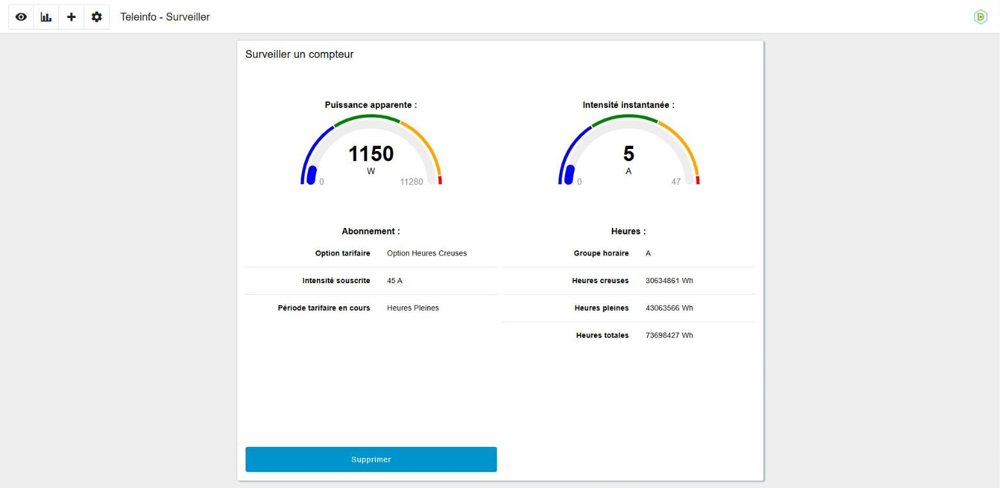
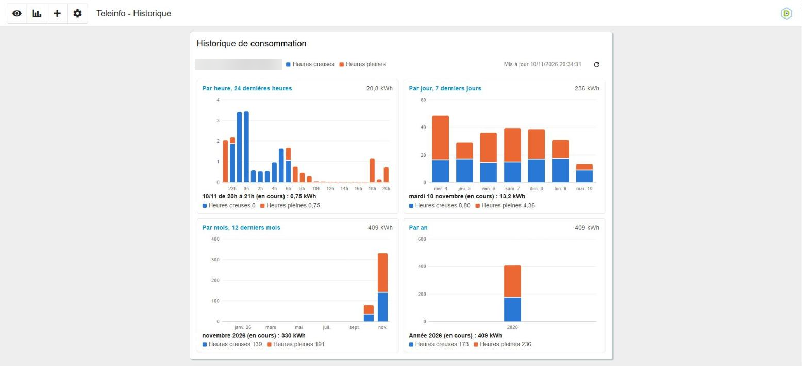
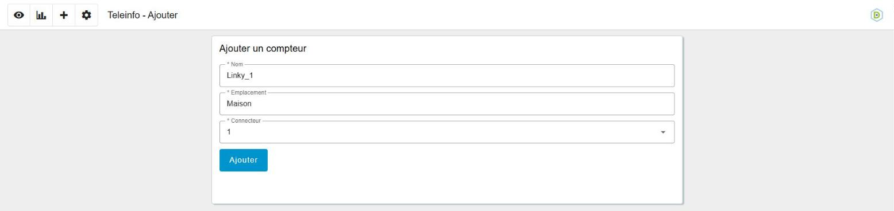
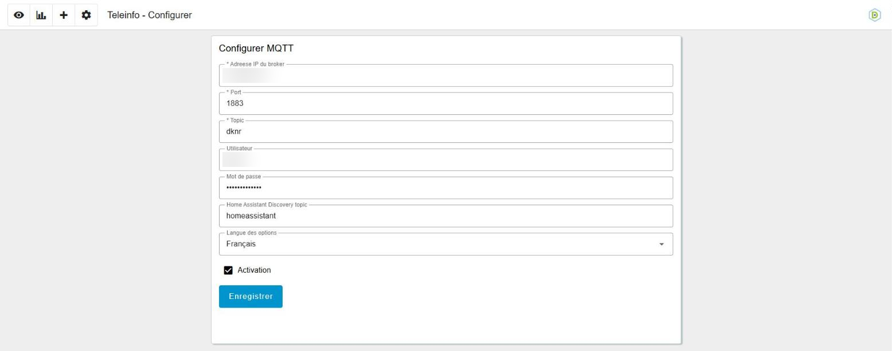

# README

## A propos

**dknr-teleinfo** est un projet consacré à la récupération et à l'exploitation des données de téléinformation d'un compteur électrique.

La documentation détaillée est sur [dknr-domotic.github.io](https://dknr-domotic.github.io/sources/teleinfo/).

Il permet de collecter les informations transmises par la sortie Téléinformation Client (TIC), puis de les rendre disponibles pour leur consultation, leur traitement ou leur intégration dans un système domotique.

## Fonctionnalités

- **Lecture de la téléinformation** provenant d'un compteur électrique compatible.
- **Décodage des trames TIC** et extraction des valeurs utiles.
- **Prise en charge des données énergétiques** telles que les index, la puissance et l'intensité.
- **Exploitation locale des mesures** pour le suivi de la consommation.
- **Intégration possible** dans une installation domotique ou un outil de supervision.
- **Supporte Home-Assistant Discovery** pour les messages MQTT.
- **Historique de consommation** enregistré dans InfluxDB : énergie par heure (24 dernières heures), par jour (7 derniers jours), par mois (12 derniers mois) et par an, détaillée par période tarifaire.

## Matériel requis

Le matériel exact dépend de l'installation, mais l'utilisation du projet nécessite généralement :

* un compteur électrique disposant d'une sortie TIC tel que le Linky.
* une interface matérielle compatible entre le compteur et la machine hôte tel qu'un clé USB TiC.
* une machine exécutant le logiciel docker.
* les droits d'accès au port USB correspondant.

## Installation

Des images Docker prêtes à l'emploi sont disponibles. 
Utilisez le fichier docker-compose.yaml à la racine du dépôt en fournissant les variables d'environnement suivant :

* **DKNR_USERNAME** : login de l'interface node-red.
* **DKNR_PASSWORD** : mot de passe de l'interface node-red.
* **DKNR_SECRET**   : un mot secret pour encrypter les credits.

### Historique de consommation (InfluxDB)

Le fichier docker-compose démarre aussi un conteneur **InfluxDB 2** (`dknr_teleinfo_influxdb`) qui conserve toutes les valeurs relevées : une mesure par minute et par compteur, sans limite de durée. La page **Historique** du tableau de bord affiche l'énergie consommée par heure (24 dernières heures), par jour (7 derniers jours), par mois (12 derniers mois) et par an.

Aucune variable supplémentaire n'est obligatoire : par défaut, dknr-teleinfo utilise le conteneur InfluxDB du docker-compose. Les variables suivantes sont optionnelles :

| Variable | Valeur par défaut | Rôle |
|---|---|---|
| **DKNR_INFLUX_TOKEN** | `dknr-teleinfo-influxdb-token` | jeton d'API InfluxDB |
| **DKNR_INFLUX_URL** | `http://dknr_teleinfo_influxdb:8086` | adresse de la base InfluxDB |
| **DKNR_INFLUX_ORG** | `dknr` | organisation InfluxDB |
| **DKNR_INFLUX_BUCKET** | `teleinfo` | bucket InfluxDB |

Au premier démarrage, InfluxDB est initialisé avec l'utilisateur **DKNR_USERNAME** et le mot de passe **DKNR_PASSWORD**, qui doit faire **8 caractères minimum**.

Quelques remarques :

* Le jeton par défaut convient tant qu'InfluxDB reste sur le réseau interne de docker. Si vous exposez le port 8086 (lignes commentées dans le docker-compose), définissez votre propre **DKNR_INFLUX_TOKEN**, par exemple généré avec `openssl rand -hex 32`.
* Le jeton, l'organisation et le bucket ne sont appliqués par InfluxDB qu'à sa **première** initialisation. Pour les changer ensuite, il faut supprimer le volume `dknr_teleinfo_influxdb` (et donc l'historique) ou les modifier dans l'interface d'InfluxDB.
* Pour utiliser une base InfluxDB 2 existante, renseignez ces quatre variables pour le conteneur dknr_teleinfo ; le conteneur InfluxDB du docker-compose (et le `depends_on` qui y fait référence) peut alors être retiré.

### Surveillance de la lecture

Après une microcoupure ou un incident sur la machine hôte (par exemple une VM Proxmox dont le port USB est partagé), la lecture de la TIC peut rester bloquée ou ne donner que des trames illisibles. dknr-teleinfo surveille donc chaque port série :

* le port passe **en défaut** après **5 trames mal décodées** de suite, ou **60 secondes sans trame valide** sur un port qui a déjà fonctionné (même après un redémarrage du conteneur) ;
* en défaut, le port est **fermé puis rouvert** automatiquement, comme si le câble USB était débranché puis rebranché. Sans retour à la normale, la réouverture est retentée après 1, 2, 4 et 8 minutes, puis toutes les 10 minutes ;
* le défaut est levé après **3 trames valides** de suite.

L'état est publié sur MQTT avec l'entité **FAULT** (`dknr/get/teleinfo/<ADCO>/FAULT`) : `1` en défaut, `0` quand la lecture est normale. Elle est déclarée en discovery DKNR (type binaire) et Home Assistant (binary_sensor de type « problem ») ; vous pouvez vous en servir comme alerte dans votre domotique.

Si le défaut persiste malgré les réouvertures, la clé USB n'est probablement plus visible sous le même nom, par exemple quand elle revient en `/dev/ttyUSB1` sur la machine hôte. Il faut alors redémarrer le conteneur, ou débrancher et rebrancher la clé. Quelques conseils pour limiter ce cas :

* sous Proxmox, partagez la clé avec la VM **par son identifiant (vendor/product)** plutôt que par son port USB ;
* sur la machine hôte, indiquez de préférence le chemin stable `/dev/serial/by-id/...` de la clé dans le docker-compose, par exemple `- /dev/serial/by-id/usb-xxxx:/dev/ttyUSB0`.

## A faire

* **Support triphasé** (UI).
* **Support multicompteur** et support multi port série/USB.
* **Configurateur** de la base InfluxDB depuis l'interface.

## Contribuer

Ce projet est **open-source**, vous pouvez participer en créant des [tickets](https://github.com/dknr-domotic/dknr-teleinfo/issues) ou en proposant de [requêtes](https://github.com/dknr-domotic/dknr-teleinfo/pulls) sur le dépôt github du projet.

## Voir aussi

- [DKNR Teleinfo](https://github.com/dknr-domotic/dknr-teleinfo)
- [DKNR APSystems](https://github.com/dknr-domotic/dknr-apsystems)
- [DKNR Daikin](https://github.com/dknr-domotic/dknr-daikin)
